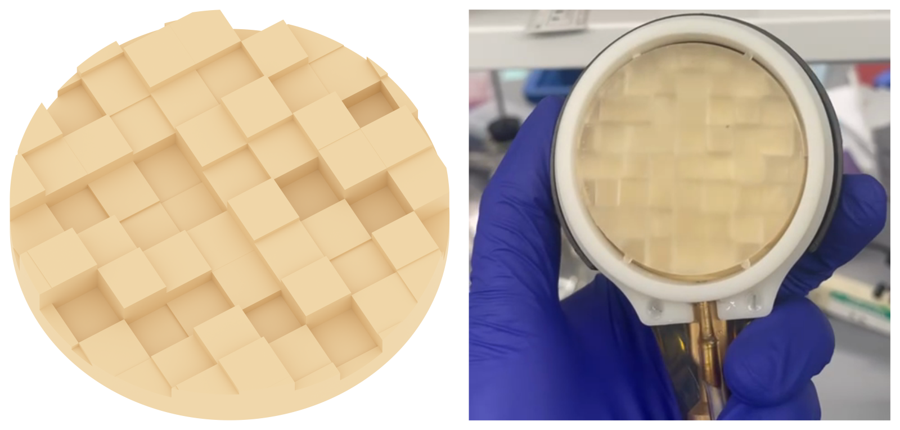
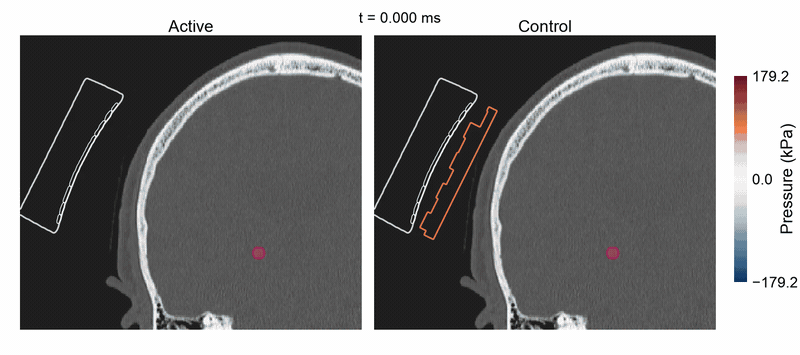

# Acoustic defocusing enables controlled transcranial ultrasound neuromodulation

Code, datasets, and results for the manuscript *Acoustic defocusing enables controlled transcranial ultrasound neuromodulation*.
This work designs and validates 3D-printed acoustic lenses that reduce ultrasound pressure at the intended brain target while preserving substantial skull exposure, providing a control condition for ultrasound neuromodulation experiments.

The repository includes lens design and acoustic simulation workflows for human and rodent transducers, hydrophone validation, and analyses of auditory and somatosensory questionnaire responses. It also provides a starting point for adapting these methods to other transducers and applications.

<p align="center">
  
</p>

<p align="center">
  
</p>

## Start here

- **Reproduce the results:** Questionnaire and hydrophone analyses can be rerun using the included data. Lens-design and transcranial summary plots can be regenerated from the supplied results. Rerunning acoustic simulations requires a compatible NVIDIA GPU. Transcranial simulations additionally require imaging and planning inputs, which are not included.

- **Adapt the code:** Use the lens design, acoustic simulation, and analysis workflows for your own applications. Examples explain which parameters and inputs to change, including transducer geometry, lens dimensions, simulation settings, and datasets.

Each workflow README provides its own execution instructions and describes the required inputs and available results.

## Installation and requirements

### Python

Python 3.10. From the repository root:

```bash
python -m venv .venv
source .venv/bin/activate
python -m pip install -r requirements.txt
```

### MATLAB

MATLAB R2024a Update 3.

Dependencies and expected locations:
- k-Wave 1.4: `dependencies/k-wave-toolbox-version-1.4/k-Wave/`
- slanCM: `dependencies/Colormaps/slanCM/`

Place the k-Wave CUDA executable in
`dependencies/k-wave-toolbox-version-1.4/k-Wave/binaries/`.

Required toolboxes:
- Parallel Computing Toolbox for GPU simulations and parallel sweeps.
- Image Processing Toolbox for NIfTI input/output.
- Signal Processing Toolbox for human lens simulations.

From the repository root:

```matlab
run('setup_matlab_paths.m');
```

### Hardware

The simulations used an NVIDIA RTX 6000 Ada Generation with 48 GB VRAM.

## Reproduce the manuscript figures

Follow each workflow README for the required inputs and commands.

| Figure panels | Workflow |
|---|---|
| 1B–D, 2A–B, S1A–B | [Human lens design](human_lens_design/README.md) |
| 2C, 5E | [Hydrophone analysis](hydrophone_analysis/README.md) |
| 3A–G, 5D, 5F–H, S2, S3 | [Transcranial propagation](transcranial_propagation/README.md) |
| 4A–D | [Questionnaire analysis](questionnaires_analysis/README.md) |
| 5A–B, S1C–D | [Rat lens design](rats_lens_design/README.md) |

## Repository organization

```text
.
├── code/
│   ├── k_wave_engine/         # Shared simulation code and configurations
│   └── postprocessing/        # Analysis and plotting scripts
├── human_lens_design/         # Human lens design workflows and results
├── rats_lens_design/          # Rat lens design results
├── transcranial_propagation/  # Human and rat transcranial simulations
├── hydrophone_analysis/       # Hydrophone validation
├── questionnaires_analysis/  # Questionnaire data, scripts, and results
└── dependencies/             # Location for MATLAB dependencies
```

## Data and additional files

Lens CAD files: https://doi.org/10.6084/m9.figshare.33065249.

## Citation

If you use this code or data, please cite:

Boscutti et al. *Acoustic defocusing enables controlled transcranial ultrasound neuromodulation*. [Publication details and DOI to be added].

## License

The original source code in this repository is licensed under the
MIT License. See [LICENSE](LICENSE) for details.

Third-party components retain their respective licenses and
copyright notices.

## Contact

- Andrea Boscutti - andrea.boscutti@ucsf.edu
- Tommaso Di Ianni - Tommaso.DiIanni@ucsf.edu
